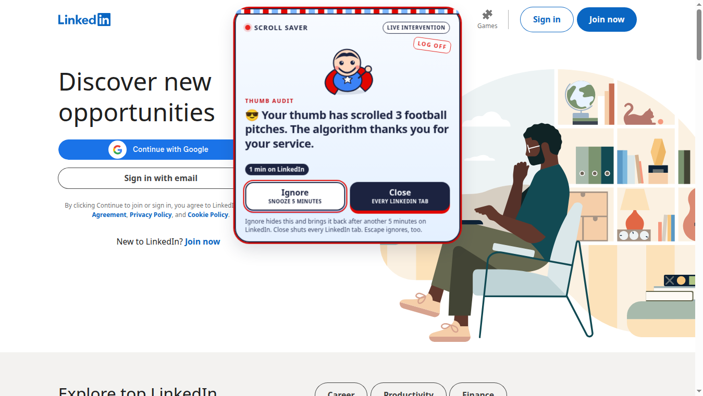

# Scroll Saver

A small Chrome extension that notices when LinkedIn has been open for a minute and sends in a smiling guy with a cape.



That card is the whole intervention, sitting on linkedin.com after the first minute. It does not take over the screen. Red bits on the card flash, Scroll Saver bobs, and both buttons are one click:

- **Ignore** hides it and brings it back after another 5 minutes of LinkedIn time.
- **Close** shuts every open LinkedIn tab.

Time is one shared clock for every `linkedin.com` tab. A tab still counts when it is in the background. Two tabs do not count twice. Leaving the site pauses the clock. Closing the tabs with the button resets it, so the next visit gets a fresh minute.

The words, the palette, and the mascot are original. Scroll Saver is not affiliated with LinkedIn.

## Install it unpacked

1. Clone this repo.
2. Open `chrome://extensions`.
3. Turn on **Developer mode**.
4. Choose **Load unpacked** and select this folder (the one that contains `manifest.json`).
5. Open [linkedin.com](https://www.linkedin.com). About 60 seconds later, Scroll Saver shows up.
6. After you change a file, click **Reload** on the Scroll Saver card.

## Test the timers faster

The durations live at the top of [`src/config.js`](src/config.js):

```js
INITIAL_THRESHOLD_MS: 60 * 1000,    // first nudge
SNOOZE_THRESHOLD_MS: 5 * 60 * 1000, // after Ignore
```

Lower them, reload the extension, then put the real values back when you are done. `HEARTBEAT_MS` is how often an open LinkedIn tab checks in.

## Develop

```bash
node --test
python3 scripts/render-icons.py
```

`demo/preview.html` draws the same overlay on a fake page so you can look at it without waiting. It is not part of the extension.

## Permissions

Host access is limited to `https://linkedin.com` and `https://*.linkedin.com`. The extension also asks for `storage` (the session clock) and `alarms` (so a background tab still counts). It does not request the broad `tabs` permission. See [SECURITY.md](SECURITY.md).

No remote code, no analytics, no network calls.

## License

[MIT](LICENSE)
